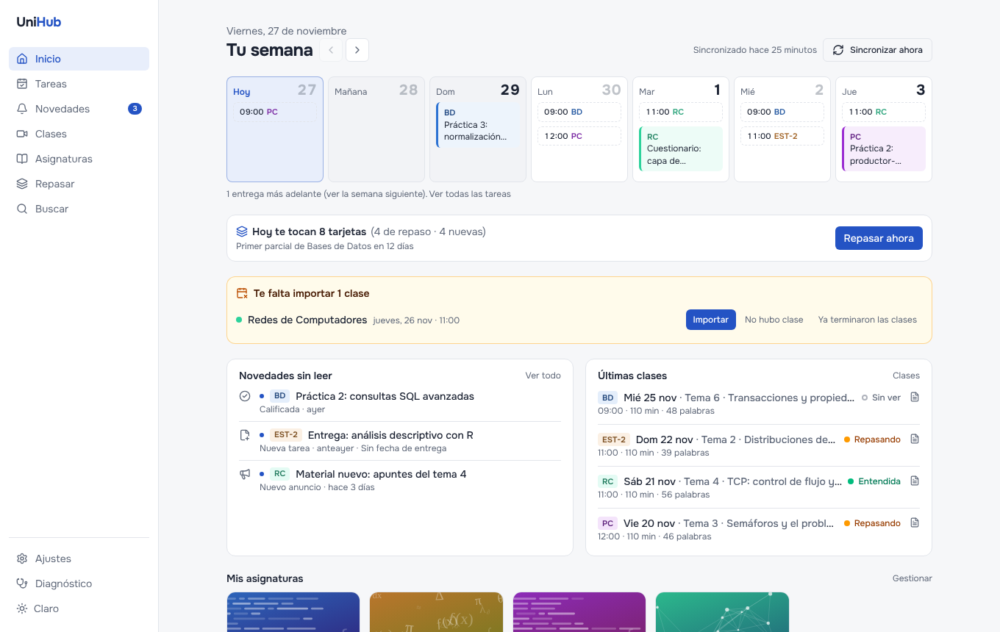
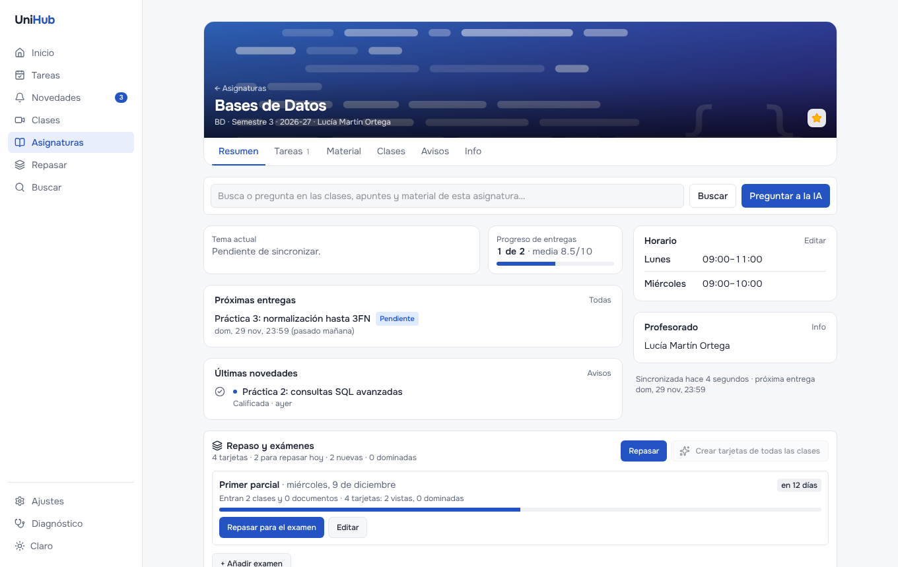
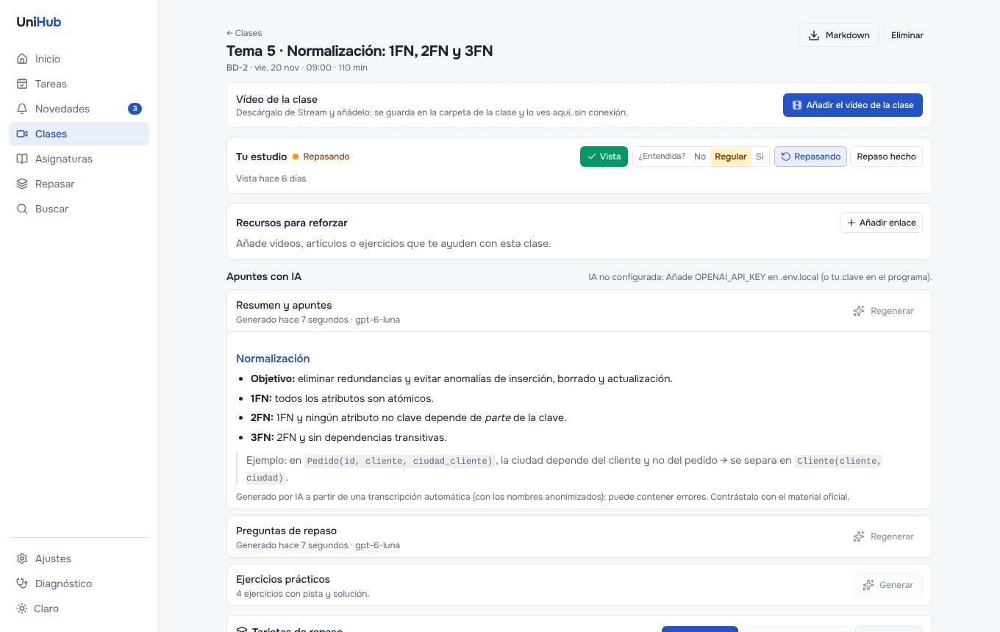
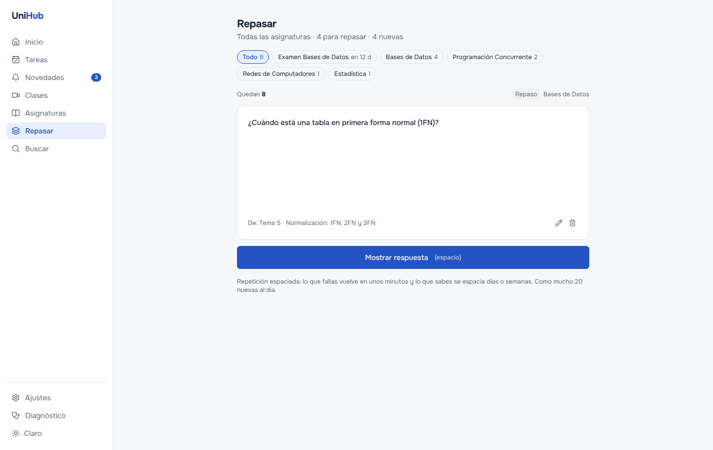
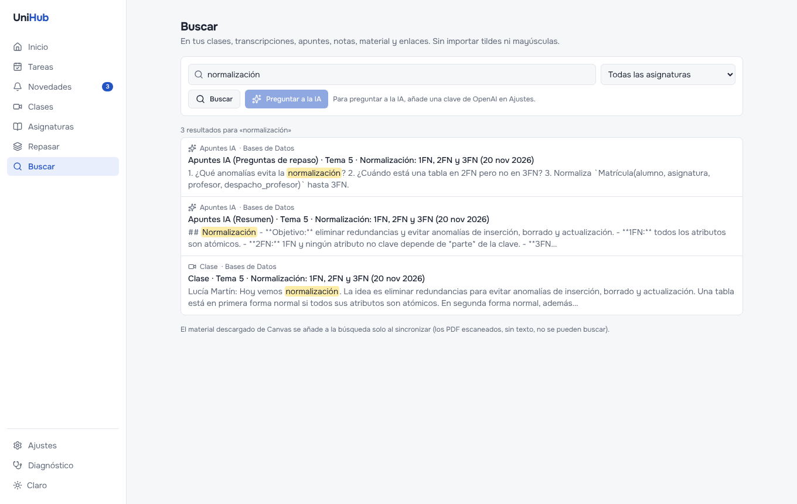
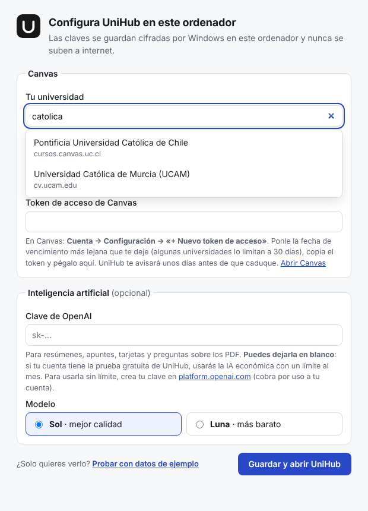

# UniHub · beta

[Español](README.md) · **English**

Your **Canvas** coursework, your **lectures** and your **notes** in one place.

UniHub connects to Canvas with your own token, organises your courses, assignments, announcements and files, reminds you of what's coming up, and helps you study with AI: lecture summaries, search across everything you have, questions answered with sources, and flashcards.

It started at Universidad Europea (Spain) and works with **any university that uses Canvas**. It's a personal open-source project meant for **everyone to install with their own keys**. It runs as a web app (on your computer or on Vercel) or as a **Windows program** that keeps all your data on your computer.

> **The interface is in Spanish.** The code, setup and this guide work the same for any language, but the app's screens are only in Spanish for now.
>
> **Beta.** It works and is used every day, but it may have bugs. Keep backups (the program makes them automatically) and open an *issue* if something breaks.
>
> **Unofficial.** Not affiliated with Instructure (Canvas) or with any university. It uses the Canvas API with your personal token, like any personal integration: check your university's usage rules.



<table>
  <tr>
    <td width="50%"><br><sub>Each course: deadlines, timetable, updates and exam review.</sub></td>
    <td width="50%"><br><sub>Each lecture: transcript, progress and AI notes.</sub></td>
  </tr>
  <tr>
    <td><br><sub>Flashcards with spaced repetition, per course or per exam.</sub></td>
    <td><br><sub>Search across everything you have, accent-insensitive.</sub></td>
  </tr>
</table>

<sub>Screenshots taken in demo mode: all the data is made up.</sub>

---

## What it does

**Canvas, organised and up to date**
- Courses with cover, colour, teachers and timetable, grouped by semester (up to 10).
- Pending assignments with due dates, submissions and grades; announcements, messages and recent changes.
- A weekly calendar on the home page with lectures and deadlines.
- Course files with a built-in viewer (PDF, text, HTML…), plus notes and links per document.
- Automatic sync and reminders before each deadline (browser or Windows notifications).
- A warning when your Canvas token is about to expire.

**Lectures**
- Import a lecture transcript (Teams `.vtt` or `.docx`, or plain text) and keep the link to the recording.
- Mark whether you've watched it, understood it and when you reviewed it; get a reminder if you forgot to import one.
- In the Windows program: save the lecture video and watch it inside UniHub.

**Study with AI** (with your OpenAI key)
- For each lecture: a summary, review questions and exercises.
- Ask the AI about any PDF in your course files: it answers with the pages it used.
- **Search** across all your transcripts, notes, annotations and files (accent-insensitive) and **ask questions about a whole course**, with sources cited.
- **Flashcards** generated by AI from your lectures and PDFs, with spaced repetition (like Anki).
- **Exams**: set the date and what's covered, and your reviews are scheduled so you get through everything in time.

**Windows program**
- All your data on your computer (embedded Postgres). It can run **without any account**: Supabase is optional and only used for sign-in.
- A UniHub folder with everything organised by course (files, transcripts, Markdown notes and videos), which you can place inside Google Drive or OneDrive.
- Daily backups, automatic recovery if something gets corrupted, and optional automatic updates.

---

## Try it without Canvas (demo mode)

You don't need Canvas, Supabase or any keys to see UniHub running. Demo mode loads made-up courses, assignments, lectures with notes, flashcards and an exam.

- **In the browser**, with the code downloaded (see [Requirements](#requirements)):
  ```bash
  npm run demo
  ```
  then open http://localhost:3000. The sample data is stored in a temporary folder and doesn't touch anything else.
- **In the Windows program:** in the first-run setup, click **"Probar con datos de ejemplo"** (try with sample data). When you want to use your own data, click **"Conectar mi Canvas"** (connect my Canvas) in the banner at the top; the demo is kept separate and never mixes with your data.

The demo doesn't sync with Canvas, and AI only works if you add your OpenAI key.

> Why isn't there a test Canvas account? In 2026 Instructure shut down its free teacher accounts, which were the usual way to try the API, and its official sandbox is paid. That's why UniHub ships its own sample data.

---

## Does it work with my university?

Yes, if your university uses **Canvas** (by Instructure). UniHub was built at Universidad Europea, but it only uses the standard Canvas API, so it works with any Canvas campus.

- **Windows program:** during the first-run setup, type your university's name and pick it from the list. Results come from Canvas's official school search, the same one its mobile app uses for "Find my school". If it doesn't show up, paste the address you see in your browser when you're on your campus; it works as is, for example `https://campus.your-university.edu/courses`.
- **Web:** set the address in `CANVAS_BASE_URL`, ending in `/api/v1`.

**How to find your campus address:** open Canvas in your browser and look at the address bar. It's usually `your-university.instructure.com`, `canvas.your-university.edu` or a custom domain. The address for UniHub is that same one with `/api/v1` at the end.

Some known Canvas campuses (already in the program's list):

| University | Country | `CANVAS_BASE_URL` |
|---|---|---|
| Universidad Europea | Spain | `https://campus.europaeducationgroup.es/api/v1` |
| UCAM · Universidad Católica de Murcia | Spain | `https://cv.ucam.edu/api/v1` |
| ENAE Business School | Spain | `https://enae.instructure.com/api/v1` |
| Pontificia Universidad Católica de Chile | Chile | `https://cursos.canvas.uc.cl/api/v1` |
| Universidad de los Andes | Chile | `https://canvas.uandes.cl/api/v1` |

Does your university use Canvas but isn't listed? Open an *issue* or a *pull request* adding it to `desktop/lib/universities.js`.

Some things may vary between universities:
- **Token:** after the 2026 Canvas security incident, some universities no longer let students create tokens, limit them to a few days, or only issue them on request. If "+ New Access Token" doesn't appear in your Canvas profile, ask your university's Canvas support; without a token UniHub can't connect.
- **Course classification:** UniHub tells real courses apart from other spaces (communities, tutoring…) by their name and dates. It's more accurate with Universidad Europea's group codes; at other universities you can choose by hand which courses to follow.
- **Recorded lectures:** transcript import is designed for Microsoft Teams (`.vtt` or `.docx`), but pasted text works too.

---

## Choose how to run it

| | Windows program | Web on your computer | Web on Vercel |
|---|---|---|---|
| Where your data lives | On your computer | In your Supabase project | In your Supabase project |
| From your phone | No | No | Yes |
| Files and videos stored locally | Yes | No | No |
| Automatic sync | Yes (every 20 min while open) | While it's open | Yes (cron) |
| Cost | Free | Free | Free (Hobby plan, personal use) |
| Needs Supabase | No (optional) | Yes | Yes |
| Difficulty | Medium (you build the installer) | Low | Medium |

The Canvas and OpenAI keys are **yours**: nobody else sees them.

---

## Requirements

- **Node.js 20.9 or later** (22 LTS recommended) and **Git**.
- For the web app: a free **Supabase** account: https://supabase.com (the Windows program doesn't need one).
- Your **Canvas token** (see below).
- Optional: an **OpenAI key** for the AI features: https://platform.openai.com
- For the program: **Windows 10/11**.

Get the code:

```bash
git clone https://github.com/AndresBustamantedev/unihub-code.git
cd unihub-code
npm install
```

---

## Step 1 · Your keys

### Canvas

1. Go to your Canvas campus → **Account → Settings**.
2. Under **Approved Integrations**, click **+ New Access Token**.
3. Give it a purpose ("UniHub") and the latest expiry date allowed. Some universities limit tokens to 30 days: UniHub will warn you before it expires.
4. Copy the token; it's only shown once.

For the web app you also need your **campus address** ending in `/api/v1`, for example `https://your-university.instructure.com/api/v1` (see [Does it work with my university?](#does-it-work-with-my-university)). In the program you just pick your university from the list.

### OpenAI (optional)

At https://platform.openai.com → **API keys → Create new secret key**. OpenAI bills usage to your account. With the cheaper model (Luna), a month of heavy use costs around $1. Recommended: in **Settings → Limits**, set a **monthly budget** and enable *Enforce a hard limit*.

---

## Step 2 · Supabase (web app only, or if you want sign-in)

If you'll only use **the Windows program without an account**, skip this whole step.

1. Create a project at https://supabase.com (free).
2. **Project Settings → API**: note the **Project URL** and the **publishable key** (`sb_publishable_…`).
3. **Authentication → Users → Add user**: create your user with your email and a password (tick *Auto Confirm User*).
4. Recommended: in **Authentication → Sign In / Providers**, turn off **Allow new users to sign up**, so only people you create can sign in.

### Web app only: the database

The Windows program creates its own database on your computer; this is only needed for the web app.

For the web app, run the migrations in `supabase/migrations/` **in order** (from `0001` to the last one). Two ways:

- **From the terminal** (Supabase CLI): `npx supabase login`, `npx supabase link --project-ref YOUR_REF` and `npx supabase db push`.
- **By hand**: in Supabase → **SQL Editor**, open each file in order, paste its contents and click **Run**. If it warns about *destructive operations*, that's because of `drop policy if exists` lines, which are safe to run.

Then **make yourself an administrator** (without this the web app won't let you save data). In the SQL Editor, with your email:

```sql
insert into public.app_admins (user_id)
select id from auth.users where lower(email) = lower('you@example.com')
on conflict (user_id) do nothing;
```

---

## Step 3A · Web app on your computer

1. Copy `.env.example` to `.env.local` and fill in at least:
   - `APP_URL=http://localhost:3000`
   - `ALLOWED_EMAILS=` your email
   - `NEXT_PUBLIC_SUPABASE_URL` and `NEXT_PUBLIC_SUPABASE_PUBLISHABLE_KEY`
   - `CANVAS_BASE_URL` and `CANVAS_ACCESS_TOKEN`
   - `OPENAI_API_KEY` if you want AI
2. Start it:
   ```bash
   npm run dev
   ```
3. Open http://localhost:3000, sign in and go to **Diagnóstico** (diagnostics) to check that Canvas responds. Then click **Sincronizar ahora** (sync now) on the home page.

To run it without development mode: `npm run build` and `npm start`.

## Step 3B · Web app on Vercel (reachable from your phone)

1. Push your copy of the code to a GitHub repository (it can be private) and import it at https://vercel.com → **Add New → Project**. You can also deploy from the terminal with `npx vercel --prod`.
2. In **Settings → Environment Variables**, add the ones from `.env.example` that you use:
   - Required: `APP_URL` (your Vercel address), `ALLOWED_EMAILS`, `NEXT_PUBLIC_SUPABASE_URL`, `NEXT_PUBLIC_SUPABASE_PUBLISHABLE_KEY`, `CANVAS_BASE_URL`, `CANVAS_ACCESS_TOKEN`.
   - For automatic sync: `SUPABASE_SECRET_KEY` and `CRON_SECRET`.
   - For AI: `OPENAI_API_KEY`.
   - Optional: push notifications (`NEXT_PUBLIC_VAPID_PUBLIC_KEY`, `VAPID_PRIVATE_KEY`, `VAPID_SUBJECT`) and `CREDENTIALS_ENCRYPTION_KEY`.
3. In Supabase → **Authentication → URL Configuration**, set your Vercel address as the *Site URL*.
4. Deploy. Variables only take effect on the next deployment.

**Automatic sync.** `vercel.json` schedules one sync a day (the free plan's maximum). For more frequent syncs, call `https://YOUR-APP.vercel.app/api/cron/sync` with the header `Authorization: Bearer <CRON_SECRET>` from an external cron (for example cron-job.org, or your hosting's cron with `docs/cron-unihub.php`).

> Never put a secret in a variable starting with `NEXT_PUBLIC_`: those are visible in the browser.

## Step 3C · Windows program (data on your computer)

On Windows, with Node.js installed:

1. Choose how to sign in:
   - **No account (simplest):** don't create `.env.local`, or leave the Supabase variables out of it. The program opens straight away with no sign-in screen, and nothing leaves your computer except the calls to Canvas and the AI.
   - **With sign-in:** create `.env.local` in the project folder with only:
     ```dotenv
     NEXT_PUBLIC_SUPABASE_URL=https://xxxx.supabase.co
     NEXT_PUBLIC_SUPABASE_PUBLISHABLE_KEY=sb_publishable_xxxx
     ```
     Use this so several people can share one installer with separate accounts, for the cloud copy, and for the AI trial.

   The program only takes these two variables from `.env.local`, and both are public. Before packaging, it checks that no secret ends up inside the program, and stops if it finds one.
2. Try the program without installing it:
   ```bash
   cd desktop
   npm install
   npm run dev
   ```
3. Build the installer:
   ```bash
   npm run dist
   ```
   You'll find it at `desktop/dist/UniHub-Setup-X.Y.Z.exe`.
4. The first time it opens, it asks for your university (search it by name), your Canvas token and, optionally, your OpenAI key. They're stored **encrypted by Windows** on your computer and never uploaded anywhere. If you just want to look around, click **"Probar con datos de ejemplo"**.



The installer isn't code-signed (a signing certificate costs money). The first time, Windows will show "Windows protected your PC": click **More info → Run anyway**.

More about the program (the UniHub folder, Google Drive, backups, restoring, automatic updates via GitHub Releases, sharing it with someone) in [`desktop/LEEME.md`](desktop/LEEME.md) (Spanish).

---

## Optional · Sharing UniHub with friends

- **Program:** give them your installer. If you built it without Supabase, each person uses it without an account; if you built it with Supabase, create a user for them (Authentication → Add user). Each person enters **their own** Canvas token and OpenAI key, and their data stays on their computer.
- **Cloud copy:** from Ajustes → Usuarios (settings → users, as administrator) you can let someone keep a copy of their data in your Supabase. If you don't enable it, Supabase rejects any of their data.
- **Free AI trial:** if you want them to try the AI without their own key, your web app can act as a proxy with **your** key, always with the cheaper model and a monthly limit per person. The key never leaves your web app. To enable it:
  1. On Vercel: `UNIHUB_TRIAL_ENABLED=1`, `SUPABASE_SECRET_KEY` and, recommended, `TRIAL_OPENAI_API_KEY` (from an OpenAI project with a spending cap). Change the per-person limit with `TRIAL_MONTHLY_USD` (default $0.50).
  2. When building the program, in `.env.local`: `NEXT_PUBLIC_UNIHUB_TRIAL_URL=https://YOUR-APP.vercel.app`.
  3. In Ajustes → Usuarios (as administrator), enable "IA de prueba" (AI trial) for each person.

---

## Security and privacy

- Your keys only live on the server (or encrypted on your computer): they never reach the browser, URLs or logs.
- Every Supabase table has row-level security (RLS): each user only sees their own data.
- Your university password (optional, to copy it in one click) is stored encrypted with AES-256-GCM and is never displayed.
- No scraping and no automated university sign-in: only the official Canvas API with your token.
- What's sent to the AI is the text of your lectures and documents, straight to OpenAI with your key.

---

## Development

```bash
npm run dev          # web app at http://localhost:3000
npm run demo         # the web app with sample data, no keys needed
npm test             # tests (Vitest)
npm run typecheck    # TypeScript
npm run canvas:check # checks the Canvas connection using .env.local
```

- **Stack:** Next.js 16 (App Router), React 19, TypeScript, Tailwind CSS 4, Supabase (Auth + Postgres with RLS); desktop program with Electron and PGlite (Postgres in WebAssembly).
- **Migrations:** in `supabase/migrations/`. If you add one, run `npm run db:local-migrations` so the desktop program applies it too. Migrations starting with `-- unihub:solo-web` only run on Supabase.
- **Layout:** `src/app` (pages and routes), `src/features` (logic per feature), `src/integrations` (Canvas and AI), `src/lib` (database, auth, utilities), `desktop/` (Windows program), `tests/`.

## License

[MIT](LICENSE). Use it, change it and share it freely.
