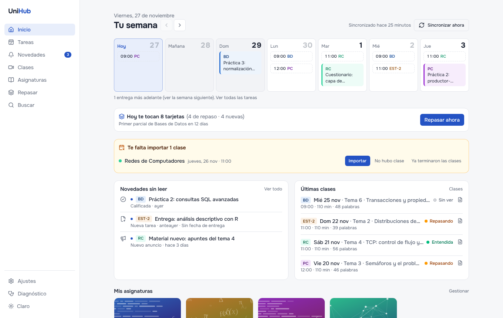
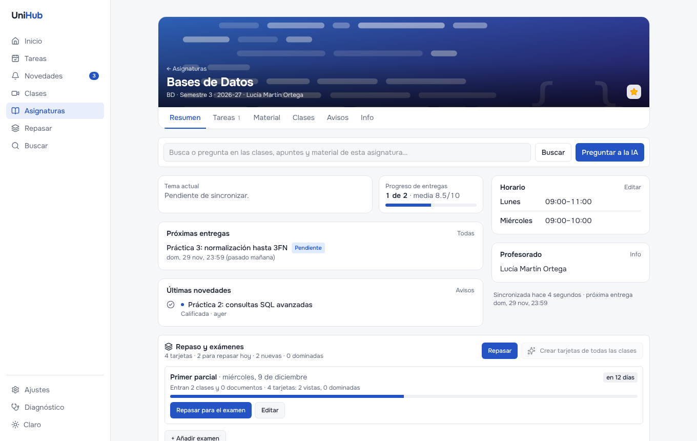
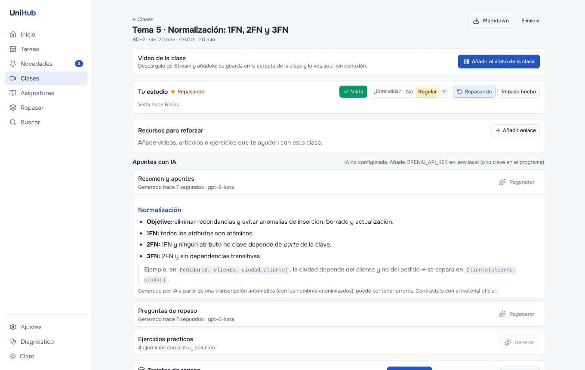
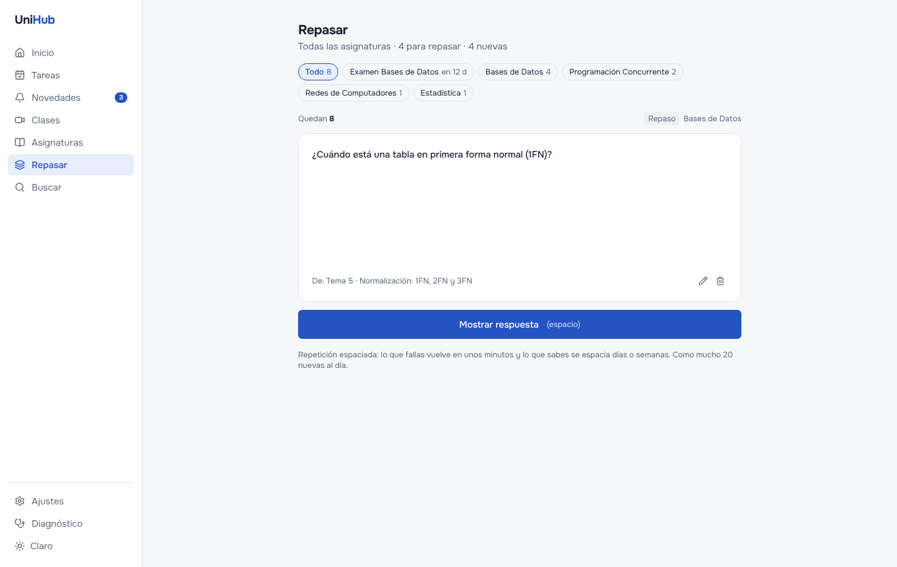
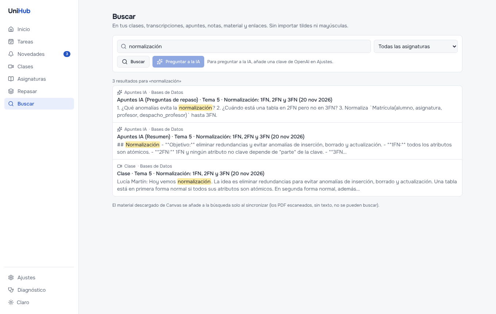
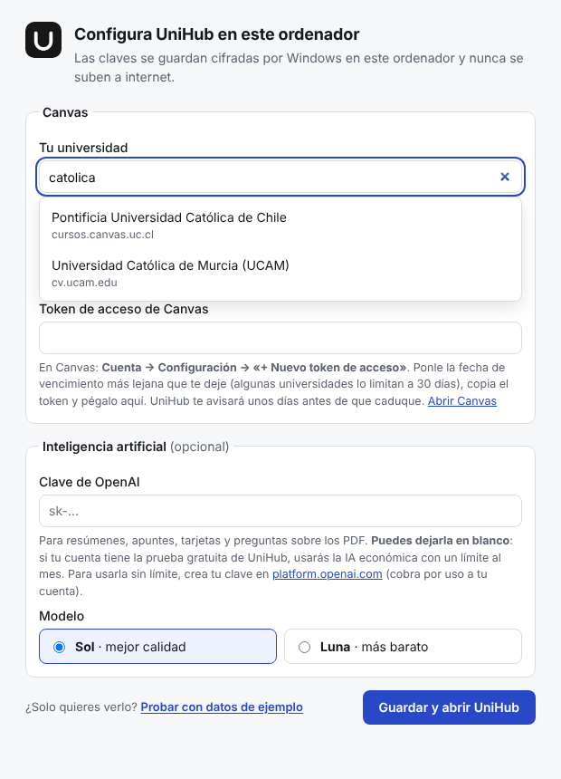

# UniHub · beta

**Español** · [English](README.en.md)

Tu actividad universitaria de **Canvas**, tus **clases** y tus **apuntes** en un solo sitio.

UniHub se conecta a Canvas con tu propio token, ordena tus asignaturas, tareas, anuncios y material, te avisa de lo que se acerca y te ayuda a estudiar con IA: resúmenes de clase, búsqueda en todo lo que tienes, preguntas con fuentes y tarjetas de repaso.

Nació para la Universidad Europea y funciona con **cualquier universidad que use Canvas**. Es un proyecto personal de código abierto pensado para que **cada persona lo instale con sus propias claves**. Funciona como web (en tu ordenador o en Vercel) o como **programa de Windows** con todos los datos en tu ordenador.

> **Beta.** Funciona y se usa a diario, pero puede tener fallos. Haz copias de seguridad (el programa las hace solo) y abre un *issue* si algo no va.
>
> **No es oficial.** No tiene relación con Instructure (Canvas) ni con ninguna universidad. Usa la API de Canvas con tu token personal, como cualquier integración propia: revisa las normas de uso de tu universidad.



<table>
  <tr>
    <td width="50%"><br><sub>Cada asignatura: entregas, horario, novedades y repaso para el examen.</sub></td>
    <td width="50%"><br><sub>Cada clase: transcripción, progreso y apuntes con IA.</sub></td>
  </tr>
  <tr>
    <td><br><sub>Tarjetas con repetición espaciada, por asignatura o por examen.</sub></td>
    <td><br><sub>Búsqueda en todo lo que tienes, sin importar tildes.</sub></td>
  </tr>
</table>

<sub>Capturas hechas con el modo demo: todos los datos son inventados.</sub>

---

## Qué puedes hacer

**Canvas, ordenado y al día**
- Asignaturas con portada, color, profesores y horario; agrupadas por semestre (hasta 10).
- Tareas pendientes con fechas, entregadas y calificaciones; anuncios, mensajes y cambios recientes.
- Calendario semanal en Inicio con clases y entregas.
- Material de cada asignatura con visor integrado (PDF, texto, HTML…), notas y enlaces por documento.
- Sincronización automática y avisos antes de cada entrega (notificaciones del navegador o de Windows).
- Aviso cuando tu token de Canvas está a punto de caducar.

**Clases**
- Importa la transcripción de una clase (Teams `.vtt` o `.docx`, o texto) y guarda el enlace a la grabación.
- Marca si la has visto, si la entendiste y cuándo la repasaste; aviso si se te olvidó importar alguna.
- En el programa: guarda el vídeo de la clase y míralo dentro de UniHub.

**Estudiar con IA** (con tu clave de OpenAI)
- Por cada clase: resumen, preguntas de repaso y ejercicios.
- Pregunta a la IA sobre cualquier PDF del material: responde con las páginas de donde sale.
- **Buscar** en todas tus transcripciones, apuntes, notas y material (sin importar tildes) y **preguntar a una asignatura entera**, con las fuentes citadas.
- **Tarjetas de repaso** creadas con IA a partir de tus clases y PDF, con repetición espaciada (como Anki).
- **Exámenes**: pones la fecha y qué entra, y el repaso se organiza para que llegues con todo visto.

**Programa de Windows**
- Todos tus datos en tu ordenador (Postgres embebido). Puede funcionar **sin ninguna cuenta**: Supabase es opcional y solo sirve para iniciar sesión.
- Carpeta de UniHub con todo ordenado por asignatura (material, transcripciones, apuntes en Markdown y vídeos), que puedes poner dentro de Google Drive u OneDrive.
- Copia de seguridad diaria, recuperación automática si algo se daña y actualizaciones automáticas (opcional).

---

## Pruébalo sin Canvas (modo demo)

Para ver UniHub funcionando no necesitas Canvas, ni Supabase, ni claves. El modo demo carga asignaturas, tareas, clases con apuntes, tarjetas y un examen inventados.

- **En el navegador**, con el código descargado (ver [Requisitos](#requisitos)):
  ```bash
  npm run demo
  ```
  y abre http://localhost:3000. Los datos de ejemplo se guardan en una carpeta temporal y no tocan nada más.
- **En el programa de Windows:** en la configuración inicial, pulsa **«Probar con datos de ejemplo»**. Cuando quieras usar tus datos, pulsa **«Conectar mi Canvas»** en la franja de arriba; la demo se queda aparte y no se mezcla con lo tuyo.

En la demo no se sincroniza con Canvas, y la IA solo funciona si añades tu clave de OpenAI.

> ¿Por qué no hay una cuenta de Canvas de prueba? Instructure cerró en 2026 las cuentas gratuitas para profesores, que eran la forma habitual de probar la API, y su entorno de pruebas oficial es de pago. Por eso UniHub trae sus propios datos de ejemplo.

---

## ¿Funciona con mi universidad?

Sí, si tu universidad usa **Canvas** (de Instructure). UniHub nació en la Universidad Europea, pero solo usa la API estándar de Canvas, así que sirve para cualquier campus Canvas.

- **Programa de Windows:** en la configuración inicial, escribe el nombre de tu universidad y elígela de la lista. Los resultados salen del buscador oficial de Canvas, el mismo que usa su app móvil en «Encuentra tu centro». Si no aparece, pega la dirección que ves en el navegador al entrar en tu campus: vale tal cual, por ejemplo `https://campus.tu-universidad.es/courses`.
- **Web:** pon la dirección en `CANVAS_BASE_URL`, terminada en `/api/v1`.

**Cómo saber la dirección de tu campus:** entra en Canvas desde el navegador y mira la barra de direcciones. Suele ser `tu-universidad.instructure.com`, `canvas.tu-universidad.edu` o un dominio propio. La dirección para UniHub es esa misma con `/api/v1` al final.

Algunos campus Canvas conocidos (vienen ya en la lista del programa):

| Universidad | País | `CANVAS_BASE_URL` |
|---|---|---|
| Universidad Europea | España | `https://campus.europaeducationgroup.es/api/v1` |
| UCAM · Universidad Católica de Murcia | España | `https://cv.ucam.edu/api/v1` |
| ENAE Business School | España | `https://enae.instructure.com/api/v1` |
| Pontificia Universidad Católica de Chile | Chile | `https://cursos.canvas.uc.cl/api/v1` |
| Universidad de los Andes | Chile | `https://canvas.uandes.cl/api/v1` |

¿Tu universidad usa Canvas y no está en la lista? Abre un *issue* o un *pull request* añadiéndola en `desktop/lib/universities.js`.

Algunas cosas pueden variar según la universidad:
- **Token:** después del incidente de seguridad de Canvas de 2026, algunas universidades ya no dejan a los estudiantes crear tokens, los limitan a pocos días o los dan solo bajo petición. Si en tu perfil de Canvas no aparece «+ Nuevo token de acceso», pregunta al soporte de Canvas de tu universidad; sin token, UniHub no puede conectarse.
- **Clasificación de asignaturas:** UniHub separa las asignaturas de los espacios que no lo son (comunidades, tutorías…) por su nombre y sus fechas. Con los códigos de grupo de la Universidad Europea acierta más; en otras universidades puedes corregir a mano qué asignaturas seguir.
- **Clases grabadas:** la importación de transcripciones está pensada para Microsoft Teams (`.vtt` o `.docx`), pero también acepta texto pegado.

---

## Elige cómo usarlo

| | Programa de Windows | Web en tu ordenador | Web en Vercel |
|---|---|---|---|
| Dónde están tus datos | En tu ordenador | En tu proyecto de Supabase | En tu proyecto de Supabase |
| Desde el móvil | No | No | Sí |
| Material y vídeos guardados en local | Sí | No | No |
| Sincronización automática | Sí (cada 20 min con el programa abierto) | Mientras esté abierta | Sí (cron) |
| Coste | Gratis | Gratis | Gratis (plan Hobby, uso personal) |
| Necesita Supabase | No (opcional) | Sí | Sí |
| Dificultad | Media (hay que compilar el instalador) | Baja | Media |

Las claves de Canvas y OpenAI son **las tuyas**: nadie más las ve.

---

## Requisitos

- **Node.js 20.9 o superior** (recomendado 22 LTS) y **Git**.
- Para la web: una cuenta gratuita de **Supabase**: https://supabase.com (el programa de Windows no la necesita).
- Tu **token de Canvas** (te explico cómo sacarlo abajo).
- Opcional: una **clave de OpenAI** para las funciones de IA: https://platform.openai.com
- Para el programa: **Windows 10/11**.

Descarga el código:

```bash
git clone https://github.com/AndresBustamantedev/unihub-code.git
cd unihub-code
npm install
```

---

## Paso 1 · Tus claves

### Canvas

1. Entra en tu campus Canvas → **Cuenta → Configuración**.
2. En **Integraciones aprobadas**, pulsa **+ Nuevo token de acceso**.
3. Ponle un propósito («UniHub») y la fecha de caducidad más lejana que te deje. Algunas universidades limitan los tokens a 30 días: UniHub te avisará antes de que caduque.
4. Copia el token; solo se muestra una vez.

Para la web necesitas también la **dirección de tu campus** terminada en `/api/v1`, por ejemplo `https://tu-universidad.instructure.com/api/v1` (mira [¿Funciona con mi universidad?](#funciona-con-mi-universidad)). En el programa basta con elegir tu universidad de la lista.

### OpenAI (opcional)

En https://platform.openai.com → **API keys → Create new secret key**. OpenAI cobra por uso a tu cuenta. Con el modelo económico (Luna), un mes de uso intenso cuesta del orden de 1 $. Recomendado: en **Settings → Limits**, pon un **tope mensual de gasto** y activa *Enforce a hard limit*.

---

## Paso 2 · Supabase (solo para la web o si quieres inicio de sesión)

Si vas a usar **solo el programa de Windows sin cuenta**, sáltate este paso entero.

1. Crea un proyecto en https://supabase.com (gratis).
2. **Project Settings → API**: apunta la **Project URL** y la **publishable key** (`sb_publishable_…`).
3. **Authentication → Users → Add user**: crea tu usuario con tu correo y una contraseña (marca *Auto Confirm User*).
4. Recomendado: en **Authentication → Sign In / Providers**, desactiva **Allow new users to sign up**. Así solo entra quien tú crees.

### Solo para la web: la base de datos

El programa de Windows crea su propia base de datos en tu ordenador; esto solo hace falta para la web.

Para la web, ejecuta las migraciones de `supabase/migrations/` **en orden** (de `0001` a la última). Dos formas:

- **Con la terminal** (Supabase CLI): `npx supabase login`, `npx supabase link --project-ref TU_REF` y `npx supabase db push`.
- **A mano**: en Supabase → **SQL Editor**, abre cada archivo en orden, pega su contenido y pulsa **Run**. Si avisa de *destructive operations*, es por líneas `drop policy if exists`, que se pueden ejecutar sin problema.

Después, **hazte administrador** (sin esto la web no te deja guardar datos). En el SQL Editor, con tu correo:

```sql
insert into public.app_admins (user_id)
select id from auth.users where lower(email) = lower('tu-correo@ejemplo.com')
on conflict (user_id) do nothing;
```

---

## Paso 3A · Web en tu ordenador

1. Copia `.env.example` como `.env.local` y rellena al menos:
   - `APP_URL=http://localhost:3000`
   - `ALLOWED_EMAILS=` tu correo
   - `NEXT_PUBLIC_SUPABASE_URL` y `NEXT_PUBLIC_SUPABASE_PUBLISHABLE_KEY`
   - `CANVAS_BASE_URL` y `CANVAS_ACCESS_TOKEN`
   - `OPENAI_API_KEY` si quieres IA
2. Arranca:
   ```bash
   npm run dev
   ```
3. Abre http://localhost:3000, inicia sesión y ve a **Diagnóstico** para comprobar que Canvas responde. Después pulsa **Sincronizar ahora** en Inicio.

Para tenerla siempre lista sin modo desarrollo: `npm run build` y `npm start`.

## Paso 3B · Web en Vercel (accesible desde el móvil)

1. Sube tu copia del código a un repositorio de GitHub (puede ser privado) e impórtalo en https://vercel.com → **Add New → Project**. También puedes desplegar desde la terminal con `npx vercel --prod`.
2. En **Settings → Environment Variables**, añade las de `.env.example` que uses:
   - Obligatorias: `APP_URL` (tu dirección de Vercel), `ALLOWED_EMAILS`, `NEXT_PUBLIC_SUPABASE_URL`, `NEXT_PUBLIC_SUPABASE_PUBLISHABLE_KEY`, `CANVAS_BASE_URL`, `CANVAS_ACCESS_TOKEN`.
   - Para la sincronización automática: `SUPABASE_SECRET_KEY` y `CRON_SECRET`.
   - Para IA: `OPENAI_API_KEY`.
   - Opcionales: avisos push (`NEXT_PUBLIC_VAPID_PUBLIC_KEY`, `VAPID_PRIVATE_KEY`, `VAPID_SUBJECT`) y `CREDENTIALS_ENCRYPTION_KEY`.
3. En Supabase → **Authentication → URL Configuration**, pon tu dirección de Vercel como *Site URL*.
4. Despliega. Las variables solo se aplican en el siguiente despliegue.

**Sincronización automática.** `vercel.json` programa una sincronización al día (el máximo del plan gratuito). Para más frecuencia, llama a `https://TU-APP.vercel.app/api/cron/sync` con la cabecera `Authorization: Bearer <CRON_SECRET>` desde un cron externo (por ejemplo cron-job.org, o el de tu hosting con `docs/cron-unihub.php`).

> Nunca pongas un secreto en una variable que empiece por `NEXT_PUBLIC_`: esas se ven en el navegador.

## Paso 3C · Programa de Windows (datos en tu ordenador)

En Windows, con Node.js instalado:

1. Elige cómo entrar:
   - **Sin cuenta (lo más sencillo):** no crees `.env.local`, o déjalo sin las variables de Supabase. El programa se abre directamente, sin pantalla de inicio de sesión, y nada sale de tu ordenador salvo las llamadas a Canvas y a la IA.
   - **Con inicio de sesión:** crea `.env.local` en la carpeta del proyecto solo con:
     ```dotenv
     NEXT_PUBLIC_SUPABASE_URL=https://xxxx.supabase.co
     NEXT_PUBLIC_SUPABASE_PUBLISHABLE_KEY=sb_publishable_xxxx
     ```
     Sirve para que varias personas usen el mismo instalador con cuentas separadas, para la copia en la web y para la IA de prueba.

   El programa solo toma de `.env.local` estas dos variables, que son públicas. Antes de empaquetar comprueba que ningún secreto acaba dentro del programa, y si encuentra alguno, se para.
2. Prueba el programa sin instalarlo:
   ```bash
   cd desktop
   npm install
   npm run dev
   ```
3. Compila el instalador:
   ```bash
   npm run dist
   ```
   Lo encontrarás en `desktop/dist/UniHub-Setup-X.Y.Z.exe`.
4. Al abrirlo por primera vez te pide tu universidad (la buscas por su nombre), tu token de Canvas y, si quieres, tu clave de OpenAI. Se guardan **cifradas por Windows** en tu ordenador y nunca se suben a ningún sitio. Si solo quieres verlo, pulsa **«Probar con datos de ejemplo»**.



El instalador no está firmado (un certificado de firma cuesta dinero). La primera vez Windows mostrará «Windows protegió tu PC»: pulsa **Más información → Ejecutar de todas formas**.

Más detalles del programa (carpeta de UniHub, Google Drive, copias de seguridad, restaurar, actualizaciones automáticas con GitHub Releases, compartirlo con otra persona) en [`desktop/LEEME.md`](desktop/LEEME.md).

---

## Opcional · Compartir UniHub con amigos

- **Programa:** pásales tu instalador. Si lo compilaste sin Supabase, cada uno lo usa sin cuenta; si lo compilaste con Supabase, créales un usuario (Authentication → Add user). Cada uno pone **su** token de Canvas y **su** clave de OpenAI; sus datos quedan en su ordenador.
- **Copia en la web:** desde Ajustes → Usuarios (administrador) puedes permitir que alguien guarde una copia de sus datos en tu Supabase. Si no lo activas, Supabase rechaza cualquier dato suyo.
- **Prueba gratuita de IA:** si quieres que prueben la IA sin poner su clave, tu web puede hacer de intermediaria con **tu** clave, siempre con el modelo económico y con un límite al mes por persona. La clave nunca sale de tu web. Para activarla:
  1. En Vercel: `UNIHUB_TRIAL_ENABLED=1`, `SUPABASE_SECRET_KEY` y, recomendado, `TRIAL_OPENAI_API_KEY` (de un proyecto de OpenAI con tope de gasto). El límite por persona se cambia con `TRIAL_MONTHLY_USD` (por defecto 0,50 $).
  2. Al compilar el programa, en `.env.local`: `NEXT_PUBLIC_UNIHUB_TRIAL_URL=https://TU-APP.vercel.app`.
  3. En Ajustes → Usuarios (administrador), activa «IA de prueba» a cada persona.

---

## Seguridad y privacidad

- Tus claves solo viven en el servidor (o cifradas en tu ordenador): nunca llegan al navegador, a las URLs ni a los registros.
- Todas las tablas de Supabase tienen seguridad por filas (RLS): cada usuario solo ve lo suyo.
- La contraseña de la universidad (opcional, para copiarla con un clic) se guarda cifrada con AES-256-GCM y nunca se muestra.
- No hay *scraping* ni automatización del inicio de sesión de la universidad: solo la API oficial de Canvas con tu token.
- Lo que se manda a la IA es el texto de tus clases y documentos, directamente a OpenAI con tu clave.

---

## Desarrollo

```bash
npm run dev          # web en http://localhost:3000
npm run demo         # la web con datos de ejemplo, sin claves
npm test             # tests (Vitest)
npm run typecheck    # TypeScript
npm run canvas:check # comprueba la conexión con Canvas usando .env.local
```

- **Stack:** Next.js 16 (App Router), React 19, TypeScript, Tailwind CSS 4, Supabase (Auth + Postgres con RLS); programa de escritorio con Electron y PGlite (Postgres en WebAssembly).
- **Migraciones:** en `supabase/migrations/`. Si añades una, ejecuta `npm run db:local-migrations` para que el programa de escritorio también la aplique. Las que empiezan por `-- unihub:solo-web` solo se aplican en Supabase.
- **Estructura:** `src/app` (páginas y rutas), `src/features` (lógica por funcionalidad), `src/integrations` (Canvas e IA), `src/lib` (base de datos, autenticación, utilidades), `desktop/` (programa de Windows), `tests/`.

## Licencia

[MIT](LICENSE). Úsalo, modifícalo y compártelo libremente.
